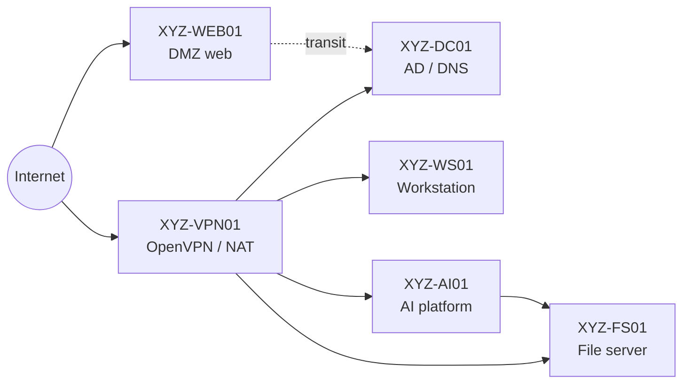

# 01 – Engagement Overview

## The Client

**XYZ Design Co.** (fictional), a mid-sized architecture and engineering design firm with offices in **San Diego, Hong Kong, and Brussels**, serving international clients. The firm was moving its environment into a private cloud and planning an internal AI assistant for its engineers.

## Our Role

Our team acted as an outside security consultancy, **ABC Security** (fictional). The work ran in two phases, with the second added through a formal change request ([CR-002](../engagement-docs/change-request-CR-002.md)). See the [sample SOW](../engagement-docs/statement-of-work.md) and [Rules of Engagement](../engagement-docs/rules-of-engagement.md). Phase 2 builds on Phase 1; it does not replace it.

| Phase | Focus | Deliverables |
|---|---|---|
| **1 – Infrastructure** | Can the private cloud be trusted before cutover? | System & Security Requirements · Vulnerability Assessment Plan & Report · Penetration Test Plan · Security Hardening Plan + Change Request |
| **2 – Enterprise AI** | Can the AI platform launch safely, and who decides? | Case Review & AI Requirements · Architecture Review · Secure Target Architecture · Threat Model & Control Catalog · Secure AI SDLC & Gates · Red Team & IR Package |

## Environment

Five in-scope hosts across three subnets in an isolated cloud sandbox. *Hostnames and IPs below are stand-ins, not the real lab addresses.*

| Host | IP | OS | Role | Subnet |
|---|---|---|---|---|
| `XYZ-DC01` | 10.20.1.10 | Windows Server 2022 | Active Directory, DNS | Business `10.20.1.0/24` |
| `XYZ-FS01` | 10.20.1.20 | Windows Server 2022 | Engineering file shares (SMB, FTP) | Business |
| `XYZ-WS01` | 10.20.1.30 | Linux | Engineer workstation (MySQL, NFS) | Business |
| `XYZ-WEB01` | 10.20.10.50 | CentOS Stream 9 | Public website — only internet-facing host | DMZ `10.20.10.0/24` |
| `XYZ-VPN01` | 10.20.200.2 | Ubuntu 22.04 LTS | OpenVPN, NAT, admin jumpbox | Public `10.20.200.0/24` |
| `XYZ-AI01` *(Phase 2)* | 10.20.1.40 | Ubuntu | Orchestrator, vector DB, Ollama, agent tools | Business |

Phase 2 added an Ubuntu AI host on the Business subnet running a **local LLM (Ollama)**, an orchestrator, a local vector database for RAG, and agent tools (shell, file write, email).

## Rules of Engagement (Summary)

- Testing confined to the sandbox; no production systems, personal devices, or provider management plane.
- All testing originated from an approved assessment workstation over the authorized VPN tunnel.
- Critical findings had to be fixed or formally risk-accepted in writing before pen testing began.
- Raw evidence retained for audit and handled per the data-handling terms in the engagement contract.

## Key Constraints for the AI Platform

- Stays fully on the private cloud; **no external LLM APIs** and no fine-tuning.
- Shadow AI tools blocked at the network layer.
- **No finalized data classification policy yet** — the design defaults to deny and relies on existing AD permissions until one exists.
