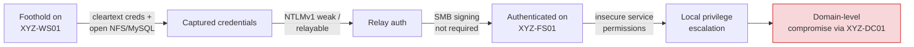

# 02 – Infrastructure Assessment (Phase 1)

## Vulnerability Assessment

**Method:** five-phase approach — planning, discovery, scanning, analysis/prioritization, reporting.
**Tools:** Nmap (discovery, ports, services), Nessus Essentials (credentialed and non-credentialed scans), Nikto (web server).

| Metric | Result |
|---|---|
| Hosts confirmed active | 5 of 5 (matched asset inventory) |
| Open ports identified | 57 |
| Raw findings | 954 |
| False positives removed | 4 (e.g., an MS08-067 hit on Server 2022, which isn't affected) |
| **Confirmed findings** | **950** |

### Severity Tiers (CVSS v3.1)

| Severity | Score | Required Action |
|---|---|---|
| Critical | 9.0–10.0 | Immediate escalation; blocks pen test and cutover |
| High | 7.0–8.9 | Fix before production |
| Medium | 4.0–6.9 | Fix within 30 days |
| Low | 0.1–3.9 | Document and monitor |

### Top Findings (Consolidated)

| ID | Finding | Hosts | CVSS | Severity |
|---|---|---|---|---|
| VUL-001 | Missing Windows cumulative updates | DC, File Server | 9.8 | Critical |
| VUL-002 | Missing .NET Framework security updates | DC, File Server | 9.8 | Critical |
| VUL-003 | OpenSSL critical vulnerabilities | Workstation | 9.8 | Critical |
| VUL-004 | Critical library flaws (glib2, GnuTLS) | Web Server | 9.8 | Critical |
| VUL-005 | Missing Linux kernel security updates | Workstation | 8.8 | High |
| VUL-006 | Insecure Windows service permissions | DC, File Server | 8.8 | High |
| VUL-007 | Missing CentOS package updates | Web Server | 7.8 | High |
| VUL-008 | Exposed MySQL database service | Workstation | 7.5 | High |
| VUL-009 | SSL/TLS misconfig (SWEET32, TLS 1.0/1.1, self-signed cert) | DC, File Server | 7.5 | High |
| VUL-010 | World-readable NFS shares | Workstation | 7.5 | High |
| VUL-011 | Unencrypted Telnet enabled | Workstation | 6.5 | Medium |
| VUL-012 | Unencrypted FTP enabled | File Server, Workstation | 6.5 | Medium |
| VUL-013 | NTLMv1 authentication enabled | DC, File Server | 5.3 | Medium |
| VUL-014 | SMB signing not required | File Server | 5.3 | Medium |
| VUL-015 | No actionable findings | VPN Gateway | — | — |

**Observation:** the VPN gateway returned no actionable findings. The web server, as the only internet-facing host, carried the broadest compliance exposure.

## Penetration Test

Planned against NIST SP 800-115 and scoped strictly to findings from the assessment.

1. **Recon** – confirm exposure, DNS enumeration, banner grabbing.
2. **Initial access** – web server first (external entry point), then the workstation.
3. **Lateral movement** – test whether exposed MySQL, open NFS, NTLMv1 relay, and missing SMB signing lead to the DC or File Server.
4. **Analysis & reporting** – attack-chain narrative plus compliance impact.

**Tools:** Nmap, Burp Suite, Netcat, enum4linux, Wireshark, Metasploit (validation only), Impacket `ntlmrelayx`, CrackMapExec.

**Outcome:** testing showed a realistic path from **credential capture → lateral movement → domain-level compromise**, driven mainly by legacy authentication and unsigned SMB.

### The Attack Chain

No single finding was catastrophic. Chained together, they were.

Each link maps to a finding and a fix — the point for the client is that breaking **any one link** stops the chain:

| Link in the chain | Finding | Break it by |
|---|---|---|
| Cleartext credentials on the wire | VUL-011, VUL-012 | Disable Telnet/FTP; use SSH/SFTP |
| Easy data / hash access | VUL-008, VUL-010 | Bind MySQL to localhost; restrict NFS exports |
| Weak, relayable authentication | VUL-013 | Enforce NTLMv2 only (refuse LM & NTLM) |
| Relay lands successfully | VUL-014 | Require SMB signing on servers and clients |
| Escalation after landing | VUL-006 | Fix service ACLs; least privilege |
| Many known exploits available | VUL-001 – 007 | Patch to current |

## Security Hardening Plan

Submitted as a formal change request (CR-001) with alternatives, rollback, and validation.

| Area | Actions | Fixes |
|---|---|---|
| Windows | Apply cumulative + .NET updates; fix service permissions; disable NTLMv1; enforce SMB signing; replace self-signed certs | VUL-001, 002, 006, 009, 013, 014 |
| Linux | Kernel and library patches; lock down MySQL; restrict NFS; disable Telnet/FTP | VUL-003, 004, 005, 007, 008, 010, 011, 012 |
| Baselines | CIS Benchmarks applied in sandbox first, then phased to production | All hosts |

### Concrete Settings

The specific changes behind the table above, so a reviewer can see we mean real configuration, not slogans:

| Finding | Setting | Change |
|---|---|---|
| VUL-013 | `Network security: LAN Manager authentication level` (GPO) | Set to *Send NTLMv2 response only. Refuse LM & NTLM* |
| VUL-014 | `Microsoft network server: Digitally sign communications (always)` | Enabled on servers and clients |
| VUL-009 | TLS protocols | Disable TLS 1.0/1.1 and 64-bit block ciphers (SWEET32); install CA-signed certs |
| VUL-008 | MySQL `bind-address` | Change `0.0.0.0` → `127.0.0.1`; add firewall rule; remove anonymous accounts |
| VUL-010 | NFS `/etc/exports` | Replace world-export with host-scoped, `root_squash`, read-only where possible |
| VUL-011/012 | Telnet / FTP services | Stop and disable; move admins to SSH and file transfer to SFTP |
| VUL-006 | Windows service ACLs | Remove non-admin write to service binaries and config; least privilege |
| VUL-001/002 | Patch state | Apply latest cumulative + .NET rollups; enable ongoing patch cadence |

### Alternatives Considered

| Option | Why not |
|---|---|
| Accept risk, defer | Proven path to domain compromise stays open |
| Compensating controls only | Firewall/monitoring helps, but root-cause flaws remain |
| **Full hardening (chosen)** | Removes root causes; lowest residual risk |

### Rollout & Rollback

Backups and VM snapshots → deploy in sandbox → functional validation → phased production rollout in maintenance windows → rescan. Rollback by snapshot restore and Group Policy reversion.

**Success criteria:** no Critical/High findings remain, the demonstrated attack path can't be reproduced, and business services stay up.
