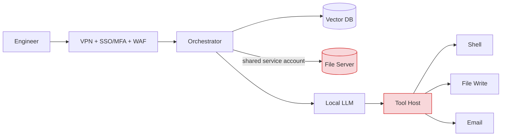
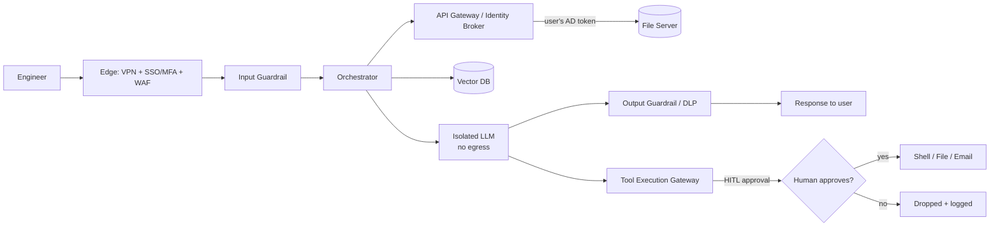

# 03 – AI Security Architecture (Phase 2)

## Current State: What We Found

The planned AI assistant had solid **edge** security (VPN, SSO/MFA, cloud WAF) but a flat, trusting **inside**.

| Problem | Why it matters |
|---|---|
| One shared service account pulls files for every user | RAG can return data the user isn't allowed to see (broken access control) |
| LLM output drives shell, file-write, and email tools directly | A prompt injection becomes code execution or data exfiltration |
| No human approval for state-changing actions | No checkpoint between AI decision and real-world impact |
| No input/output inspection | Injection, poisoning, and sensitive data leaks go unchecked |
| No data classification | Can't enforce GDPR/PDPO boundaries or align with NIST AI RMF / ISO 23894 |



## Design Principles

1. **Least privilege, user-context authorization** — retrieve data *as the user* via AD, never as a super-account.
2. **Explicit trust boundaries** — treat the LLM as untrusted and isolate it from tools and the network.
3. **Human-in-the-loop (HITL)** — any state-changing action needs informed human approval.
4. **Guardrails on both sides** — inspect prompts going in and responses coming out.

## Target State



### New Components

| Component | Job |
|---|---|
| **API Gateway / Identity Broker** | Replaces the shared account; passes the user's AD token so RAG only sees what the user can see |
| **AI Security Gateway (Input/Output Guardrails)** | Blocks injection attempts in; applies DLP and output sanitization out |
| **Tool Execution Gateway** | Sole path to tools; pauses every action for human approval and shows the **raw** command |
| **Isolated inference zone** | LLM host has default-deny egress, so a compromised model or package can't phone home |

### Trust Boundaries

| Boundary | Between | Enforced by |
|---|---|---|
| Edge | Internet ↔ internal | WAF, VPN, SSO/MFA |
| Authorization | User ↔ data | API Gateway (user-context propagation) |
| Inference | Orchestrator ↔ LLM | Guardrails; LLM treated as untrusted |
| **Execution (critical)** | LLM ↔ tools | Tool Execution Gateway + HITL |

> **Compliance flag:** until the data classification policy is finalized, the platform runs **default-deny** and relies on existing AD permissions. That's a stopgap, not a substitute — DLP rules have nothing formal to enforce against.

## What the Controls Look Like

Illustrative configurations, to show the design is concrete and enforceable. Values are examples, not a production drop-in.

### Identity Broker — retrieve as the user, not a shared account

The single biggest fix. RAG retrieval carries the requesting user's identity, so the vector search can only ever return chunks sourced from files that user's AD groups already allow.

```yaml
# API Gateway / Identity Broker
retrieval:
  identity: propagate            # use caller's AD token; no shared service account
  on_missing_token: deny
  vector_query:
    filter: acl_groups ANY-IN ${user.ad_groups}   # pre-filter by source-file ACL
  audit: [user, query_id, doc_ids_returned, timestamp]
```

### AI Security Gateway — guardrails in and out

```yaml
input_guardrail:
  max_prompt_tokens: 4096        # also blunts resource-exhaustion (threat 9)
  block_on:
    - injection_heuristics       # "ignore previous instructions", role-swap, system-prompt probes
    - known_jailbreak_signatures
  on_block: {drop: true, log: input_guardrail, alert: sec_ops}

output_guardrail:
  dlp_scan: true                 # pattern + classifier scan before response leaves
  actions:
    restricted_match: redact
    executable_payload: block    # scripts / XSS / command-like output
  log: [verdict, rule_id, redaction_count]
```

> The DLP ruleset is only as good as the **data classification policy**. Until that exists, these rules match ad-hoc patterns, which is exactly the gap flagged for launch gate G2.

### Tool Execution Gateway — nothing runs without a human

The LLM can *propose* an action; it can't perform one. Every state-changing call pauses for human approval, and the approval screen shows the **exact** command, not the model's summary of it (closing the "human approval manipulation" threat).

```yaml
tool_gateway:
  default: deny
  tools:
    file_write: {approval: human, scope: user_home_only}
    email_send: {approval: human, show_recipients_raw: true}
    shell_exec: {approval: human, show_command_raw: true, allowlist: [] }
  approval_prompt:
    display: raw_action           # never only the AI's natural-language summary
    timeout: deny                 # ignored prompt = denied, not approved
  audit: [proposed_action, raw_command, approver, decision, timestamp]
```

### LLM isolation — assume breach

```text
XYZ-AI01 inference zone:
  egress: default-deny            # LLM host cannot reach the internet
  allowed_out: orchestrator:internal only
  model/package updates: manual, reviewed, from vetted source
```

Even a poisoned model or dependency can't call home or exfiltrate, because there's no outbound path to use.
