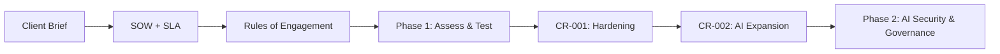

# Engagement Documents (Sample)

> **⚠️ Demo documents.** In the real course, the client case study and contract documents were supplied by the instructor and are not reproduced here. To show the full consulting lifecycle, we wrote **our own original versions** for a fictional client and firm. Any resemblance to real organizations is coincidental. Nothing here is a real contract or legal advice.

## Cast (Fictional)

| Role | Name |
|---|---|
| Client | **XYZ Design Co.** — design firm with offices in San Diego, Hong Kong, and Brussels |
| Consultancy | **ABC Security** — our team |
| Client sponsor | Chief Information Security Officer (CISO) |
| Executive escalation | Chief Executive Officer (CEO) |
| Our lead | Engagement Lead |

## Documents

| Doc | Purpose | When it's used |
|---|---|---|
| [Client Brief](client-brief.md) | The situation and what the client asked for | Kickoff |
| [Statement of Work](statement-of-work.md) | Scope, deliverables, timeline, acceptance | Before any work starts |
| [Service Level Agreement](service-level-agreement.md) | Response times, escalation, quality commitments | For the full engagement |
| [Rules of Engagement](rules-of-engagement.md) | What we can and can't touch during testing | Before scanning or pen testing |
| [CR-001 – Hardening](change-request-CR-001.md) | Adds remediation work after testing | After pen test |
| [CR-002 – AI Expansion](change-request-CR-002.md) | Expands scope to the enterprise AI platform | Start of Phase 2 |

## How They Fit Together

Names are placeholders in brackets wherever a signature would go.
